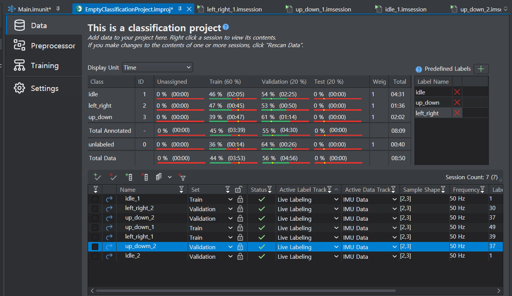
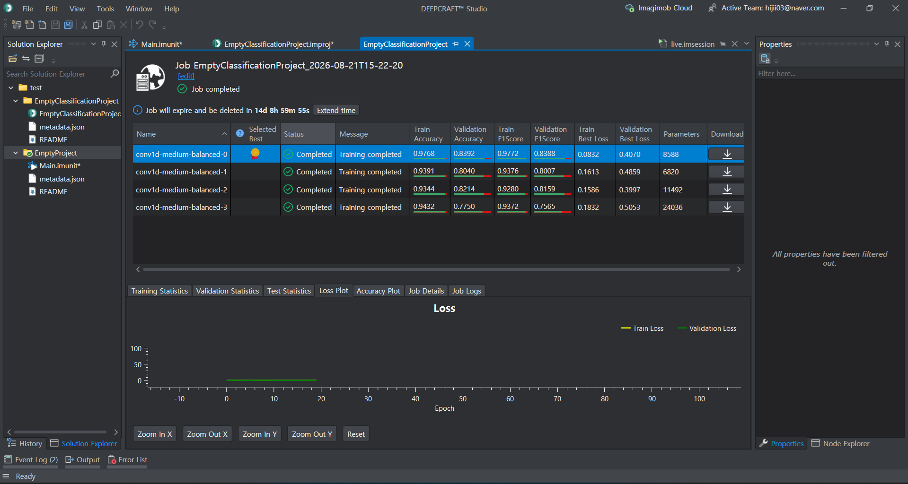
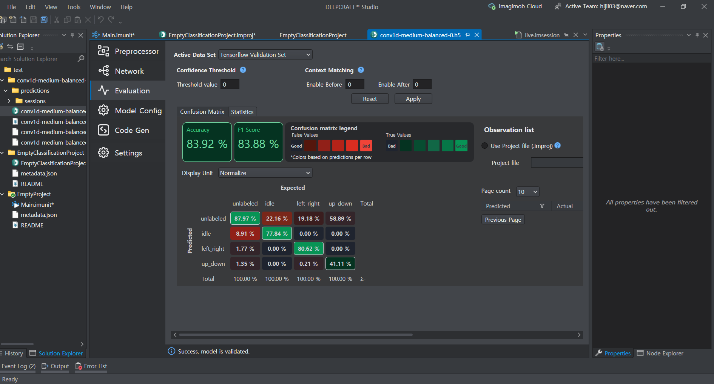
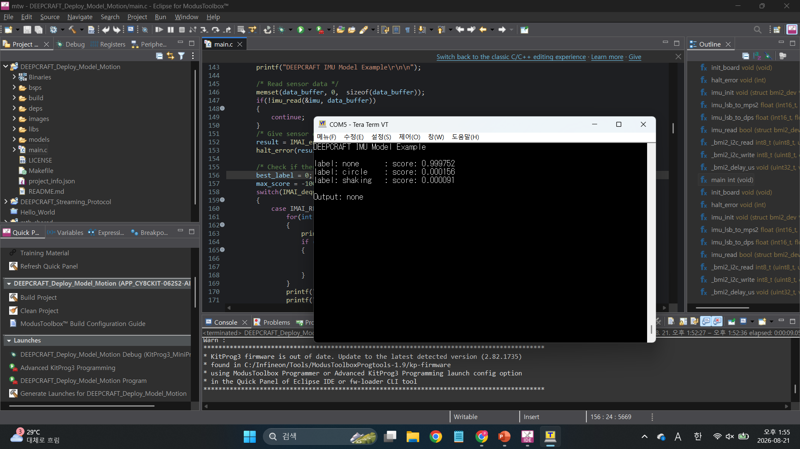
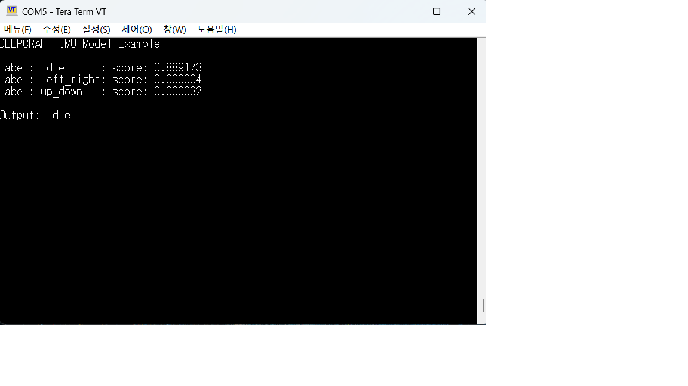

# PSoC 6 Edge AI: IMU 동작 분류 (TinyML)

> **DGIST MCU 실습 캠프** (2026.08.21) 실습 기록
> Infineon PSoC 6 AI Kit의 IMU 데이터로 동작 분류 모델을 직접 학습시키고, 보드에 올려 실시간으로 추론했습니다.

## 왜 엣지 AI인가

클라우드 AI는 성능이 좋지만, **개인정보 보호, 전송 지연, 응답 시간**이 중요한 장치에서는 센서 옆의 MCU에서 바로 추론하는 엣지 AI가 필요합니다. 이번 실습에서 작은 저전력 모델로 TinyML의 데이터 수집부터 보드 탑재까지 전 과정을 경험했습니다.

## 환경

| 항목 | 내용 |
| --- | --- |
| 보드 | Infineon PSoC 6 AI Evaluation Kit (CY8CKIT-062S2-AI) |
| 센서 | BMI270 6축 IMU (보드에는 마이크 2채널, 레이더 센서도 탑재) |
| 학습 | DEEPCRAFT Studio (데이터 라벨링, 클라우드 학습, C 코드 생성) |
| 배포 | ModusToolbox (Eclipse IDE), Tera Term으로 결과 확인 |

## 과정

~~~
IMU 데이터 녹화 → 라벨링 → 클라우드 학습 → 모델 선택·평가 → C 코드 생성 → 보드 업로드 → 실시간 추론
~~~

### 1. 데이터 수집과 라벨링

`idle`, `left_right`, `up_down` 세 가지 동작을 IMU로 녹화하고 직접 라벨링했습니다. 학습용과 검증용으로 각각 두 번씩 녹화했습니다.

### 2. 클라우드 학습과 평가

DEEPCRAFT Studio가 여러 모델을 학습시키고 가장 정확한 모델을 골라줍니다. 선택된 모델은 `conv1d-medium-balanced`였습니다.

| 지표 | 결과 |
| --- | --- |
| Accuracy | 83.92 % |
| F1 Score | 83.88 % |
| idle 정답률 | 77.84 % |
| left_right 정답률 | 80.62 % |
| **up_down 정답률** | **41.11 %** (58.89 %가 unlabeled로 오분류) |

### 3. 보드 탑재와 실시간 추론

생성된 모델 코드를 ModusToolbox로 보드에 올렸습니다. 메인 루프는 IMU 값을 읽어 `IMAI_enqueue()`로 모델에 넣고, `IMAI_dequeue()`로 라벨별 점수를 받아 가장 높은 동작을 출력합니다.

| 예제 모델 (none / circle / shaking) | 직접 학습한 모델 (idle / left_right / up_down) |
| --- | --- |
|  |  |

## 배운 점

- **데이터 라벨링이 가장 오래 걸립니다.** 아직은 사람이 하나하나 구간을 지정해야 합니다.
- **녹화 방법이 정확도를 좌우합니다.**
    - idle도 책상에 가만히 두지 말고 약간의 움직임을 줘야 실제 상황과 비슷해집니다.
    - 동작 앞뒤로 1~2초씩 멈춰야 동작 구간이 깔끔하게 구분됩니다.
- **ATmega128과 완전히 다른 개발 방식.** 레지스터와 인터럽트를 직접 짜던 ATmega128과 달리, 모델 코드와 주변장치 설정 대부분을 툴이 생성해 줍니다. 대신 학습된 가중치는 사람이 해석할 수 없는 숫자 배열이라, 성능은 결국 데이터 품질에 달려 있다는 걸 느꼈습니다.
- 툴(DEEPCRAFT, ModusToolbox)은 기능이 많은 만큼 처음 쓰기에는 복잡했습니다.

## 참고

- 블로그 원문: [DIGIST Dia lab MCU 실습 캠프](https://blog.naver.com/homeless112/224388659097)
- 보드 예제 코드(main.c)는 Infineon 예제를 그대로 사용해 이 레포에는 포함하지 않았습니다.
